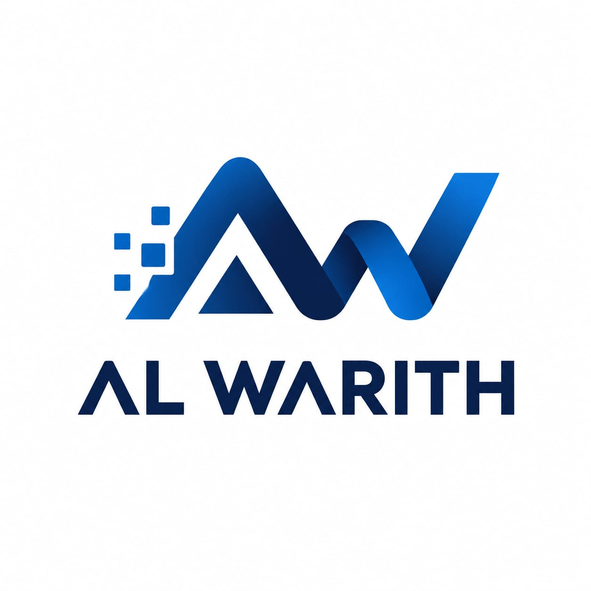

<<<<<<< HEAD
# منصة الإسناد الأكاديمي

تطوير وإشراف شركة **AL WARITH**.



منصة ويب تعليمية عربية تجمع المحتوى والتقييم والتعلم المباشر والمسجل والتواصل بين الطالب والمعلم. راجع [سياق المشروع للفرق والمساعدات البرمجية](docs/PROJECT_CONTEXT.md) لفهم المتطلبات وحالة التنفيذ والفجوات، وراجع [دليل المساهمة](CONTRIBUTING.md) لسير العمل بين الفريقين.

## Technology Stack

The target stack below is specified by the project requirements. The current repository is a Django/SQLite prototype and does not yet match the target backend and database. See [PROJECT_CONTEXT.md](docs/PROJECT_CONTEXT.md) for the full analysis.

### Core Technologies

| Layer | Technology | Purpose |
| --- | --- | --- |
| Frontend | HTML5 | Page structure |
| Frontend | CSS3 | Styling, responsive layouts, and RTL support |
| Frontend | JavaScript (ES6+) | Client-side interactions |
| Backend | PHP 8.4+ | Server-side business logic |
| Database | PostgreSQL | Persistent data storage |
| Database queries | SQL | Data definition and manipulation |
| Database connectivity | PHP PDO | Secure database access with prepared statements |
| Data exchange | JSON where APIs are required | API request and response format |
| Version control | Git | Source code versioning |
| Documentation | Markdown | Project documentation |

### Architecture

The target application follows a client–server architecture:

- **Frontend:** Provides the responsive Arabic user interface and client-side interactions.
- **Backend:** Processes requests, enforces business rules, authenticates users, and checks authorization on the server.
- **Database:** PostgreSQL stores persistent application data.
- **Data exchange:** JSON is used where API-based communication is required.

### Development Principles

- Prioritize performance under low-bandwidth network conditions.
- Support Arabic interfaces and right-to-left (RTL) layouts.
- Validate user input on the server side.
- Use parameterized database queries and secure password hashing.
- Enforce role-based access control on the server.
- Keep presentation, business logic, and data access appropriately separated.
- Document required software versions, PHP extensions, and environment configuration.

### Target Runtime Requirements

- PHP 8.4 or a newer compatible release.
- PostgreSQL and the PHP `pdo_pgsql` extension.
- A compatible web server, such as Apache or Nginx.
- Git for development and version control.

Exact runtime versions and configuration must be verified before deployment. The target PHP/PostgreSQL runtime is not configured in the current repository.

## Current Repository Prototype

The code currently in this repository is a Django application using SQLite. It supports account registration and login, a basic course catalog, course details, enrollment, and lessons. It does not yet implement the full platform described in the BRD/SRS or the target PHP/PostgreSQL stack.

### Run the current Django prototype locally

Requirements: Python 3.12 or a compatible version for the pinned Django release, and Git.

```bash
git clone <repository-url>
cd alesnad_platform
python -m venv .venv
source .venv/bin/activate  # Windows: .venv\Scripts\activate
python -m pip install -r requirements.txt
cp .env.example .env      # Windows: copy .env.example .env
python manage.py migrate
python manage.py runserver
```

Set a random local key in `.env`. Do not commit `.env` or the local `db.sqlite3` database. This run guide applies only to the current prototype, not the target PHP/PostgreSQL deployment.

## تقسيم العمل بين الفريقين

- **الخلفية:** منطق الخادم، الحسابات والصلاحيات، البيانات والترحيلات، المسارات وواجهات API، التكاملات والأمان.
- **الواجهة:** صفحات الويب والقوالب وHTML وCSS وJavaScript، والتجاوب وRTL وإتاحة الاستخدام.
- **مشترك:** عقود البيانات والواجهات، وتغييرات القوالب المعتمدة على بيانات الخادم، والتوثيق والتغييرات التي تمس الطرفين.

المشروع مستودع واحد. اتفقوا على شكل البيانات والمدخلات والمخرجات والصلاحيات وحالات الخطأ قبل تنفيذ ميزة عابرة للفريقين. استخدموا فرعًا لكل مهمة وافتحوا Pull Request إلى الفرع الافتراضي. عند إنشاء المستودع على GitHub، اجعلوا `main` الفرع الافتراضي، ولا تدفعوا التغييرات إليه مباشرة.

## هيكل المشروع

```text
accounts/   الحسابات في نموذج Django الحالي
courses/    الدورات والدروس والتسجيل في نموذج Django الحالي
core/       الصفحة الرئيسية
config/     إعدادات Django ومسارات المشروع الحالية
templates/  قوالب HTML
assets/     CSS وJavaScript والصور والخطوط
docs/       وثائق BRD وSRS وسياق المشروع
SqlDigram/  مخطط قاعدة البيانات التصوري
```

المخطط في `SqlDigram/` تصور أولي، ولا يمثل قاعدة البيانات الحالية. لا تعتبر أسماء الكيانات أو المتطلبات دليلًا على وجود تنفيذ؛ راجع [سياق المشروع](docs/PROJECT_CONTEXT.md) لتفاصيل الفجوات والقرارات المفتوحة.
=======
# alesnad_platform
>>>>>>> 302ddcf56fe6deb2c84384be044ea86d1ff29025
